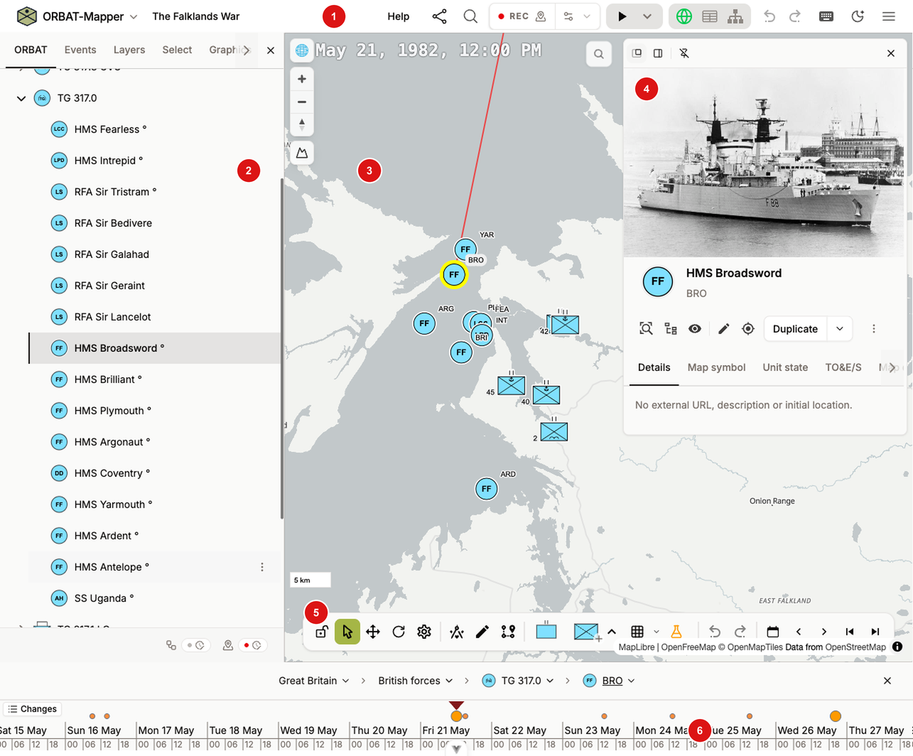
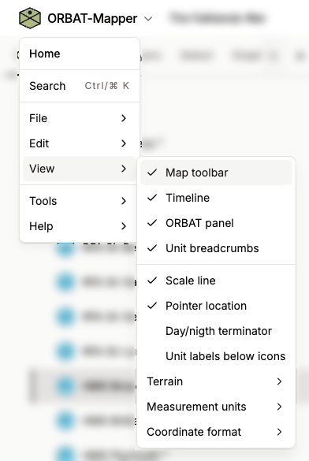

# Map edit mode

The map edit mode is the primary editing mode. It has these main parts:

1. Navigation bar
2. Sidebar (ORBAT, Events, Layers, Select, Graphics, Settings and Tools tabs)
3. Map
4. Details panel
5. Map toolbar
6. Timeline

## Navigation bar

The navigation bar is at the top of the screen. It has these items, from left to right:

- **Main menu**: the ORBAT Mapper logo.
- **Scenario name**: click it to see the scenario information.
- **Save**: this button shows only when the scenario has changes that you did not save. Click it to save the scenario.
- **Help**, **Share scenario** and **Search**.
- **Rec**: the recording control. Refer to [Recording](#recording).
- **Playback**: the play/pause button and the playback menu. Refer to [Playback](#playback).
- **Editing mode switch**: MapLibre view (map), Grid and Chart. Refer to [Editing modes](editing-modes).
- **Undo** and **Redo**.
- **Keyboard shortcuts** and **Toggle dark mode**.
- **Settings** (hamburger menu): the map view, the [base layers](map-layers), the ORBAT display, and the time and date
  settings. These settings are for your device. The scenario does not keep them.

### Main menu

The main menu gives you almost all the scenario actions:

- **File**: save, load, download, share, import and export the scenario. It also has _Export map as image_ and
  _Duplicate scenario_.
- **Edit**: undo, redo, revert to the saved version, and copy or paste the scenario with the clipboard.
- **View**: show or hide parts of the screen (map toolbar, timeline, ORBAT panel, unit breadcrumbs, scale line,
  pointer location). This menu also has the unit label options, the measurement units, the coordinate format and the
  **Terrain** submenu.
- **Tools**: _Browse symbols_.
- **Help**: the documentation and the keyboard shortcuts.

To search for units, features, places and actions, press **Ctrl/Cmd+K**.

## Sidebar

The sidebar is on the left side. It has these tabs:

| Tab          | Use it to                                                          |
| ------------ | ------------------------------------------------------------------ |
| **ORBAT**    | See and change the hierarchy of sides, groups and units.           |
| **Events**   | See the scenario events.                                           |
| **Layers**   | Control the feature layers, control-measure layers and more.       |
| **Select**   | Select many units by category.                                     |
| **Graphics** | Find a control measure and draw it on the map.                     |
| **Settings** | Change the scenario settings. The scenario keeps these settings.   |
| **Tools**    | Export the map as a PNG image, with print sizes and a custom area. |

### ORBAT tab

The ORBAT tab shows the order of battle (sides, groups and units) as a tree that you can expand.

#### Browse and select

- To select a unit, click it. To select a range, hold **Shift** and click. To select or deselect one unit, hold
  **Ctrl/Cmd** and click.
- To move in the tree, use the **arrow keys**.
- To expand or collapse a unit, click the chevron icon. To open or close a full side, use the expand/collapse actions
  at the side level.
- To find units by name, click the **filter** icon of a side. Then type in the _Filter_ field. The location filter
  switch shows only the units near the current map view.

#### Drag and drop

::: tip
The unit symbol is the drag handle. Drag the symbol, not the name of the unit. When the pointer is on the symbol, it
changes to a move cursor.
:::

- To place a unit on the map, drag its symbol from the ORBAT tab and drop it on the map. _Unit position_ recording
  must be on.
- To put units in a different sequence or below a different parent, drag their symbols to a different position in the
  tree.
- To make copies of the dragged units, hold **Ctrl/Cmd** and drag.
- To make copies of the units with their state (positions and timeline data), hold **Ctrl/Cmd+Alt** and drag.
- You can drag more than one selected unit at the same time.
- If _Unit hierarchy_ recording is on, the application records the change at the current scenario time. Refer to
  [Recording](#recording).

#### Clipboard

- **Ctrl/Cmd+C** copies the selected units. **Ctrl/Cmd+V** puts them into the target unit.

#### Context menus

Right-click a side, a group or a unit, or use its dropdown menu. You then get actions such as edit, add subordinate,
duplicate, move up/down, hide/show on map, lock/unlock and delete.

- You cannot drag or change locked units and groups.
- _Hide on map_ removes the unit from the map, the range rings, the unit tracks and the GeoJSON/KML exports. The unit
  stays in the ORBAT, but it is dimmed. Hide a unit does not hide its subordinates. To hide them also, select _Hide on
  map (with subordinates)_. The scenario keeps this setting.

### Layers tab

The Layers tab shows the scenario layers in the sequence that the map draws them:

- **Feature layers**: points, lines, polygons, rectangles and circles.
- **Control-measure layers**: tactical graphics such as phase lines, boundaries and attack arrows.
- **Map layers**: image, XYZ tile and TileJSON layers. Refer to [Map layers](map-layers).
- **Range rings**: all the range rings of the units. Refer to [Range rings](#range-rings).

To add a layer, use the button at the bottom of the tab. To change the sequence of the layers, drag them.

Move the pointer on a layer or an item to see its actions:

- **Zoom to**: zoom the map to the layer or to the item.
- **Toggle visibility**: show or hide the layer or the item. The tab dims the hidden items.
- **More actions**: set as active layer, edit, move up/down, duplicate, copy as GeoJSON and delete.

New features go into the **active layer**. You can lock a control-measure layer to prevent changes.

Some layers and items show only part of the time. By default, the tab does not show the items that are hidden at the
current scenario time. To see them, set the **Show time-hidden items** switch to on.

### Select tab

Use the Select tab to select many units at the same time. Click a category row to select its units. The counts and the
results use the current scenario time.

The categories are: _Side_, _Main unit icon_, _Command level_, _Unit status_, _Map visibility_, _Standard identity_,
_Symbol status_, _HQ / Task force / Dummy_ and _Symbol modifiers_. The tab hides the categories that cannot change the
selection.

The **Add/Narrow** switch is at the top of the tab:

- **Add**: click a category to add its units to the selection. Click it again to remove them.
- **Narrow**: click a category to keep only the selected units in it. For example, select _Land unit_, then go to
  _Narrow_ and click a side. You then get the land units of that side.

Other actions at the top of the tab:

- **Invert**: select all the units that are not selected.
- **Clear**: clear the selection.
- **Show all hidden**: show all the units that are hidden on the map.

When you select units, a footer shows the number of selected units. It has these actions:

- **Zoom to**: zoom the map to the selected units that have a location at the current time.
- **Hide** and **Show**: hide or show the selected units on the map.

### Graphics tab

The Graphics tab is a catalogue of all the control measures.

- To find a control measure, type in the search field, or use the filters: _All_, _Points_, _Lines_, _Areas_, _Tasks_
  and _Generic_.
- To draw a control measure, click it. Then draw on the map. To cancel, click it again.
- To put a control measure at a specified position, drag it and drop it on the map.
- Use the footer to change the cell size, to collapse or expand the sections, and to show the descriptions.

The **px/m** switch sets the size of new point symbols:

- **px**: the symbol keeps the same size on the screen when you zoom.
- **m**: the symbol has a size on the ground, and it becomes larger or smaller with the map.

### Settings tab

The Settings tab has the scenario settings. The scenario keeps them. The sections are:

- Equipment categories, personnel categories, supply categories, supply classes and supply units of measure
- Range ring groups
- Unit statuses, each with an optional colour
- Map settings and bounding box
- Symbol fill colors
- [Custom unit symbols](custom-symbols)

## Map

The map is the central work area. It shows the units as military symbols, and you draw the map features and the control
measures on it.

### Operate on units

- To select a unit, **click** its symbol. To add a unit to the selection, hold **Shift** and click. To select all the
  units in an area, **drag a box** on the map.
- Click on the symbol of the unit, not on its labels. If units are on top of each other, the application selects the
  nearest unit.
- To place a unit on the map, drag its symbol from the [ORBAT tab](#orbat-tab) or from the unit breadcrumbs and drop it
  on the map. _Unit position_ recording must be on.
- To move a unit to a new position, **drag** it. _Unit position_ recording must be on.
- Unit symbols have a rotation that you can set, and labels that show the names of the units.

### Map controls

The map controls are in the top-left corner of the map:

- **Globe**: show the map as a globe or as a flat map.
- **Zoom** and **compass**: the compass shows the rotation and the tilt of the map.
- **Terrain**: set 3D terrain and hillshading to on or off. When you set terrain to on, the map tilts to show the
  relief. When you set it to off, the map becomes flat again. If the button is amber, there is no elevation data.
  Refer to [Terrain and hillshading without an internet connection](offline-use#terrain-and-hillshading-without-an-internet-connection).

To change the terrain settings, use the **Terrain** submenu. It is in the map context menu and in _View_ in the main
menu. There you can set the exaggeration, the hillshade settings and the source of the elevation data. The application
keeps these settings between visits.

### Map context menu

Right-click the map to open the context menu. A target marker shows the position that you clicked. The menu has these
items:

- The coordinates of the position. Click them to copy them.
- **Orbit here**: refer to [Orbit mode](#orbit-mode).
- **Units** and **Features** at the position.
- **Add**: add a unit or a point at the position.
- **Map base layer**, **Map flavour** and **Terrain**: refer to [Map layers](map-layers) and
  [Offline use](offline-use).
- **Map settings**: coordinate format, measurement units, unit rotation, scale line, pointer location, feature
  tooltip, day/night terminator, unit labels and the Hellfire option.
- **Playback** and options to show or hide parts of the screen.

On a unit track in edit mode, the menu also has _Convert waypoint to via point_ and _Convert via point to waypoint_.

### Orbit mode

In orbit mode, the camera moves to a position and turns slowly around it.

- To start, select **Orbit here** in the map context menu. As an alternative, press **O** to orbit the center of the
  screen.
- To select a new center, click the map.
- When you zoom or tilt the map, the orbit stops for a short time. It starts again after the gesture.
- To stop, press **O** or **Escape**.

#### Hellfire strike

The Hellfire strike is an optional animation for orbit mode. To set it to on, go to _Map settings_ in the map context
menu and select _Hellfire (orbit mode)_. You can also use the command palette (**Ctrl/Cmd+K**).

To fire a missile at a position, hold **Shift** and click the map while it orbits. As an alternative, use the
_Hellfire_ submenu in the map context menu. The _On impact_ setting tells the application what to do with the units
that the missile hits:

- Nothing (only the animation)
- Hide units
- Remove units from map
- Delete units
- Set destroyed status

You can also set the map shake to on or off. Each strike is one undo step.

### Range rings

Range rings are circles around a unit, for example to show the range of a sensor or a weapon.

- To add a range ring, select the unit. Go to the **Map display** tab in the details panel. Then click _Add_ in the
  _Range rings_ section.
- You can put range rings into **range ring groups**. The map shows the rings of a group as one shape where they
  overlap.
- Range rings follow the zoom visibility range of their unit.

In the [Layers tab](#layers-tab), the _Range rings_ row controls all the range rings:

- Show or hide all the range rings, one group, or the ungrouped rings. The scenario keeps these settings. They do not
  change the visibility setting of each ring.
- Open a group to see its rings. Each ring has its own visibility toggle.
- Add a range ring group, change its name, and change its style.
- Drag the _Range rings_ row to change where the map draws the rings.

## Map toolbar

The map toolbar is at the bottom of the map. It has these tools:

- **Select unit**, **Move unit** and **Rotate unit**. To move units, _Unit position_ recording must be on. In rotate
  mode, drag on a unit (or on the selected units) to set the rotation of the symbol at the current scenario time.
- **Keep tool active to add multiple**: use the same tool again and again.
- **Measurements**: measure lengths and areas.
- **Draw**: opens the [draw toolbar](#draw-toolbar).
- **Unit track**: show and change the tracks of the units.
- **Add unit**: select the echelon and the symbol, then click the map to add a unit.
- **Toggle reference grid**: refer to [Reference grid](#reference-grid).
- Undo, redo, and buttons that go to the previous or next day or event.

### Measurements

The measure toolbar has the _Length_ and _Area_ tools. You can also show the segment lengths, a range circle and
great-circle paths, keep more than one measurement, and snap to near objects.

### Unit tracks

Select **Unit track**, then **Show unit track** to see the path of the selected units. To change the path, also select
**Edit track**:

- To add a waypoint, hold **Ctrl/Cmd** and click the map. The application calculates the time from the speed of the
  unit.
- To move a waypoint or a via point, drag it.
- To add a via point, drag the midpoint handle of a leg.
- To delete a waypoint or a via point, hold **Alt** and click it. You cannot delete the initial location.
- To change a waypoint into a via point, or a via point into a waypoint, right-click it.

### Draw toolbar

Use the draw toolbar to make control measures and map features. The tools are in these groups:

- **Control measures**: the pinned control measures. The toolbar pins up to five control measures, for example the
  ones that you used last. **All…** opens a search of all the control measures. The palette button sets the style of
  the selected control measures. If you did not select a control measure, it sets the style of new control measures.
- **Shapes**: _Point_, _Line_, _Polygon_, _Rectangle_ and _Circle_. A **Freehand** mode is available for lines and
  polygons.
- **Options**: _Keep tool active to add multiple_, _Snap to grid_ and _Record feature geometry_.
- **Selection**: this group shows only when you select map items:
  - **Edit**: change the vertices of the selected item.
  - **Move**: move the selected items.
  - **Duplicate** and **Delete**.

A new control measure goes into edit mode immediately. To edit a selected control measure, you can also click it
again. If the scenario has no layer for the new item, the application makes one.

On a touch device, an action bar shows while you draw. Use it to finish or cancel the drawing.

### Reference grid

Use the **Toggle reference grid** button to show or hide a coordinate grid. Its dropdown has **MGRS** and
**latitude/longitude** grids, interval controls, colour, opacity and line width. The map automatically draws a
readable subset of the selected finest interval as you zoom.

The grid settings are display preferences for the current device. The scenario does not keep them. The application
keeps the selected mode, intervals and appearance, but each new map starts with the grid hidden.

## Details panel

When you select a unit or a map item, the details panel shows. It gives related data and editing controls.

### Unit details

The header shows the symbol, the name, the short name and the status of the unit. Click the symbol to change it. If the
unit has no short name, click _Add short name_ to add one. A locked unit shows a lock icon. Click it to unlock the
unit.

The toolbar below the header has these actions: zoom to, show in ORBAT, hide on map, edit, set location, and more
actions (duplicate, move, create subordinate, delete, clear state). Move the pointer on a button to see its tooltip. If
a button is disabled, the tooltip tells you why.

The panel has these tabs:

- **Details**: name, short name, description, external URL and initial location.
- **Map symbol**: SIDC code and the appearance options of the symbol.
- **Unit state**: timeline entries. They show position changes, status changes and other recorded state at each time.
- **TO&E/S**: table of organization, equipment and supplies.
- **Map display**: the zoom levels where the unit shows on the map, and the [range rings](#range-rings).
- **Properties**: maximum speed and average speed with selectable units of measure.

#### Edit many units at the same time

Select more than one unit to edit them together. The header shows the number of selected units. You can remove units
from the selection there.

You can set the status, change the symbol, remove the units from the map, edit the text amplifiers and the speeds, lock
the units, and remove TO&E items. The change applies to all the selected units, but not to locked units. Each change is
one undo step.

If a field has different values for the selected units, it shows **Mixed**.

### Control measure details

When you select a control measure, the panel has these tabs:

- **Style**: colour, line width, echelon and size.
- **Amplifiers**: the text labels of the control measure.
- **Details**: name, description and the doctrinal description of the control measure.
- **State**: the state entries at different times.

The toolbar has zoom to, duplicate, style, edit shape and edit data. In edit mode you can also move the labels and
change the arrow widths. Hold **Alt** and click a width grip to reset it.

### Feature details

When you select a map feature, the panel has these tabs:

- **Style**: visibility, marker (for points), stroke, arrows (for lines), fill and text labels.
- **Details**: name, description and media.
- **State**: the state entries at different times. You can also give the track of the feature to a unit.
- **Transform**: make a new geometry with operations such as buffer, convex hull, simplify and smooth.

## Recording

The recording controls specify which changes go on the scenario timeline while you edit. The **Rec** button in the
navigation bar shows the current recording state.

### Recording modes

There are three independent recording modes. You can set each mode to on or off:

- **Unit position**: records the changes of the unit locations on the map. Only this mode is on by default. Thus, the
  timeline immediately records the units that you move on the map. If this mode is off, you cannot drag units to new
  positions on the map.
- **Unit hierarchy**: records the changes of the organizational structure of the units. If this mode is on, the
  application makes an entry with a time on the timeline when you drag a unit to a new parent or when you change the
  sequence of the units in the ORBAT tab. It does not change the hierarchy directly.
- **Feature geometry**: records the changes of the shapes of the map features (points, lines, polygons). If this mode
  is on, the application makes a timeline entry when you draw or change the geometry of a feature. It does not change
  the feature directly. You can also set this mode in the _Options_ group of the draw toolbar.

All the recorded changes have the current scenario time. When you move along the timeline, the scenario shows the
projected state at each time. This state comes from the recorded entries.

### Use the Rec button

Click the **Rec** button to set the recording to on or off:

- When the recording is on, a red indicator and icons show which modes are on.
- When you click the button, all recording stops.
- When you click the button again, your previous recording configuration starts again. The application keeps your last
  selection.

Use the dropdown menu on the right side of the button to open the **Recording Settings**. There you can set each
recording mode to on or off independently.

## Timeline

The timeline is at the bottom of the map editor. It shows the time range of the scenario. An amber histogram shows the
times that have many changes.

### Move in time

- To go to a time, **click** that position on the timeline.
- To move continuously through the scenario, **drag** to the left or to the right.
- To zoom in and out, use the **scroll wheel**.
- **Event markers** (amber circles) show the scenario events. To go to an event, click its marker.

The time controller shows the current scenario time. It also has buttons that go to the previous day, the next day,
the previous event and the next event.

### Playback

Use the playback controls in the navigation bar to animate the scenario in time:

- **Play/Pause** (**K**) starts or stops the automatic movement of the time.
- **Speed** is the scenario time for each real second, for example _15 h/s_. This is the default. Use **Speed up**
  (**>**) and **Slow down** (**<**) to change it.
- **Loop playback** plays the selected time range again and again.
- **Add marker** sets the start and the end of the playback range. **Clear markers** removes them.

### Unit changes

The **Unit changes** panel shows the changes of the units and the map items:

- Click a bar of the histogram to see the changes in that time interval.
- Click the **Changes** button on the timeline, or press **H**, to see the changes near the current time.

The panel has two views:

- **List**: the changes in time sequence. A line shows the current time. Links go to the previous and the next change.
- **Lanes**: one lane for each unit or map item, on a time axis. You can show the trips of the units. To move a change
  to a different time, drag it. The change snaps to the changes on near lanes, to the scenario events and to the
  current time. Hold **Alt** to snap only to a 5-minute grid. To select many changes, drag a box.

To filter the changes, use the kind of change, the name, or _Only in map view_. Select the time window, from ±1 hour to
±7 days. The panel can float over the map or dock below it. The application keeps the view, the columns and the sort
sequence.

### Context menu

Right-click the timeline to get more options:

- Zoom in / Zoom out
- Add a scenario event at the time that you clicked
- Hide the timeline
