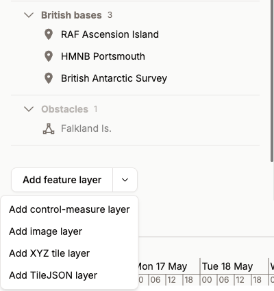

# Work with map background layers

ORBAT Mapper has two types of background layers:

- **Base layers**: the basemap below all other layers. Only one base layer is active at a time. Your device keeps the
  base layer settings. The scenario does not keep them.
- **Map layers**: images and tile layers on top of the basemap. The scenario keeps them.

## Base layers

To select the base layer, open the **Settings** menu (hamburger menu) in the navigation bar. Then go to the
**Map layers** tab. As an alternative, right-click the map and select _Map base layer_.

The _Base layers_ section shows the available basemaps. There you can also:

- Change the opacity of the base layer.
- Open a basemap archive from your disk with **Open PMTiles archive…**.
- Add a basemap from a server with **Add map server…**.
- Select the **flavour** (colours) of a vector basemap archive.

For more data about basemap archives and map servers, refer to [Offline use](offline-use).

## Map layers

ORBAT Mapper supports these map layer sources:

- [XYZ tiles](#xyz-tiles)
- [TileJSON](#tilejson)
- [Images](#images)

To add a map layer, open the **Layers** tab in the sidebar. Then use the button at the bottom of the tab and select
_Add image layer_, _Add XYZ tile layer_ or _Add TileJSON layer_. The new layer shows in the Layers tab with the
feature layers and the control-measure layers. Drag it to change its position in the sequence.

### XYZ tiles

XYZ map tiles divide a map into small square tiles in a grid. A web browser can load these tiles quickly. Each tile is
a small image of a small area of the map. The XYZ system makes the index and the retrieval of the tiles easy.

### TileJSON

[TileJSON](https://github.com/mapbox/tilejson-spec/tree/master/3.0.0) is a format that uses JSON. It gives a simple
description of a set of XYZ map tiles. TileJSON is better than XYZ tiles, because it usually also gives the
attribution, the available zoom levels and the extent.

### Images

An image layer is one image on top of the map at a specified location. You can turn it and change its size to make it
agree with the map.

## KML/KMZ

To add a KML or KMZ file as a temporary map layer, use the [import data](import-data) dialog. To open the dialog, drag
the file and drop it on the map, or select _File_ > _Import data..._ in the main menu. If you select the "Extract KML styles" option, ORBAT Mapper tries to use the images
and the styles in the file.

The application keeps KML/KMZ layers in memory. Thus, do not add too many of them. Use them only as temporary reference
layers. You cannot save them as part of the scenario. In the Layers tab, a _Temp_ badge shows these layers.
